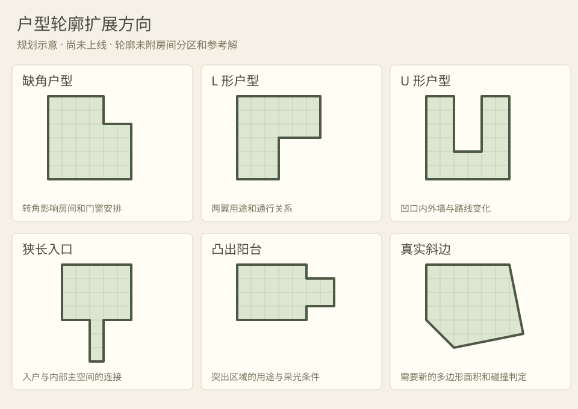

# 非规则户型与地图扩展

状态：2026-11-22，0.4.0已实现L/U形、缺角、狭长入口、阳台、错位双翼、柱墙/管井/天井和45°斜切角，准确范围见[实现记录](RELEASE_0.4.0.md)。下文保留后续几何规划；顶部图仍是早期示意，不是参考解验证凭证。

## 当前能力及目标

当前地图是1米整格的连通占地集合。玩家可通过矩形追加绘制非矩形房间，复杂模板也已有凸出入口；但生成器仍主要用矩形房间和走廊拼接，仅有三个结构族，不能代表丰富的非规则住宅。当前门窗边界只有水平和垂直两类，不支持真正斜墙。

目标同时覆盖外轮廓、内部房间形状、固定建筑障碍和入口/门窗条件。地图有凹凸而所有题仍是同一房间关系，或只旋转镜像现有模板，都不足以交付户型扩展。

户型和家具共同设计：给可用空间选择家具组合，或按委托家具要求筛选能容纳的轮廓；不能挖掉任意格子后硬塞全部物件。主体房间应有可用空间，允许角落和局部不便形成推理，但不能靠无意义细缝或反复断路增加难度。

## 分阶段支持

| 阶段 | 户型与建筑条件 | 实现要求 |
| --- | --- | --- |
| H1 整格非规则轮廓 | 缺角、L/T/U/Z形、阶梯边、凸出阳台、狭长入口和双翼布局 | 基于现有网格实现多个真正不同的用途/通行结构，不只是轮廓装饰 |
| H2 内部固定结构 | 柱位、固定墙段、管井、天井/内院、局部不可用区、固定入口 | 建筑区域和边界分类；固定结构不能擦除，门窗权限由区域类型决定 |
| H3 真正非直角几何 | 梯形、斜切角、多边形房间、斜边飘窗 | 多边形几何、面积、摆放碰撞、墙段门窗、方向条件和绘制命中一起升级 |
| 后续候选 | 弧形边、多层/复式及楼梯 | 另建几何或楼层连接能力；本轮不宣称支持 |

H1的阶梯形只是整格正交轮廓，不称作真实斜墙。H3之前不发布需要斜墙正确判定的题。

## 不同轮廓带来的玩法

- 缺角和L形：改变可形成的房间组合、外墙与窗的位置，家具旋转可能决定能否放下。
- U形和双翼：公共空间、私密空间与通行路径重新组织；在凹口处可开窗与否由明确建筑边界配置决定。
- 狭长入口：处理入户路线和主空间的连接。走廊占比与瓶颈有质量上限，不用无尽长走廊占满地图。
- 凸出阳台或局部突出：配置为独立用途区或房间延伸；面积计入方式和边界要求写入关卡规则。
- 柱位、固定墙和管井：保留不能占用/拆除的空间，围绕它安排家具和通路，不允许画房间或移动物件穿过结构。
- 梯形与斜切角：部分格子面积、墙边家具与旋转组合形成新问题；使用真实碰撞范围，不能只看外接矩形。

这些是本项目计划的原创扩展，不能当作已确认的原作规则。涉及用途、采光或留空的要求，只按游戏明确条件判定，不引入未说明的现实标准。

## 区域和边界必须分类

规划数据分别描述可规划室内区域、可规划室外附属区域、固定占用区、封闭管井、开放天井/内院以及建筑外部；每类配置是否计入面积、能否分房、能否开门窗和能否进入。

不能把轮廓内部的所有空洞都当作外部：当前引擎会把占地内外之间的门视为入户门，直接挖一个管井会错误产生额外“外墙”和入户位置。H2须先补外轮廓与内孔边界分类，封闭管井不自动提供窗或入户门。开放内院是否允许窗、门或通行由题目数据指定。

固定墙段和柱位保存于关卡快照，使用清晰的固定标记。房间区域可以凹入或绕过固定结构，但须连通且有可用通路。固定条件在需求/接单说明中可发现，不能提交后才突然增加。

## 斜边几何的升级范围

H3引入版本化多边形：外环、内孔、固定区域和带稳定ID的墙段。当前格子格式继续读取，不把旧数据重新解释为新的几何。

- 面积按真实可规划多边形计算，部分格子不是整格计数；使用固定精度和清楚的显示/比较规则，拒绝仅靠浮点四舍五入通关。
- 家具旋转后的完整碰撞范围必须位于可用房间内，不能越斜墙、柱位或孔洞。使用区另行检查，不与碰撞区域混淆。
- 门窗沿实际墙段定位，校验长度、端点、固定元素和相邻区域；非水平/垂直墙不冒充旧的h/v边。
- 北南东西保持世界方向。“某一面斜墙”的要求通过墙段ID/明确墙面描述表达，不随意归到北墙或东墙。
- 铅笔仍可拖出矩形，并与固定建筑轮廓求交/并集；无需让玩家使用复杂CAD才能完成题目。预览、擦除、面积反馈与审核使用同一几何定义。
- 户型绘制、历史只读图、后台参考图、求助、撤销和手机墙边命中同步适配，不能只把外边框画成斜线。

## 生成与质量

先选结构族和用途/连接关系，确定入口、固定区域及可开窗墙面，再构造可用分区和家具参考解，提取阶段允许的线索，用同一引擎复验。H1使用有语义的翼部、凹口和连接模块，不采用无约束随机挖格子。

质量检查至少覆盖：整体/各房间连通、通往入口、瓶颈宽度、家具及使用区可达、门口留空、不可用区域隔离、可用面积比例、走廊占比、固定结构冲突、窗所在墙段权限。阈值为游戏设计参数，需按内容组合与试玩校准。

难度记录凹角数量、狭窄连接、固定障碍、可开窗面、有效家具摆位和跨房依赖；不把边数多或面积大直接当成难。图形指纹考虑平移、旋转与镜像，功能连接也纳入去重。

沿用主内容方案的Worker、预算和同阶段回退要求；回退题不能丢掉引入关必需的新户型类型。每个结构族须有多组固定种子和已验证参考解，再进入普通委托池。

## 引入节奏和验收TODO

现有草稿保留。第12关计划引入冰箱，第13关复用冰箱并首次引入简单L形；第14关茶几，第15关缺角；第16关电视柜，第17关狭长入口。此为C2配套目标，只有家具和户型各自通过验收才发布，不在同一关首次叠加新家具、斜墙和全新通行规则。

- [ ] H1a 首批L形、缺角、狭长入口三个结构族：用途和通行关系确有变化，有参考解，支持当前全部编辑操作和手机。
- [ ] H1b 扩展U/T/Z形、阳台和双翼：逐类验证，避免只交换房间名称或镜像充数。
- [ ] H2 区域/内孔/固定墙分类：入户、门窗、面积、擦除、通路和存档不会混淆外部与内部孔洞。
- [ ] H3 版本化多边形几何及完整交互：梯形、斜切角正反例、真实面积/碰撞、墙段引用、旧题兼容。
- [ ] H4 结构族分布、形状和功能去重、难度/性能指标、超预算回退及实际试玩。

0.4.0已完成H1a、U形/阳台/错位等H1b子集、H2核心区域分类及H3半格45°切角。一般多边形、任意斜率、曲线和多层仍待实施；H4已具备基础重复筛选、阶段预算和限时回退，尚未完成实玩难度校准。
